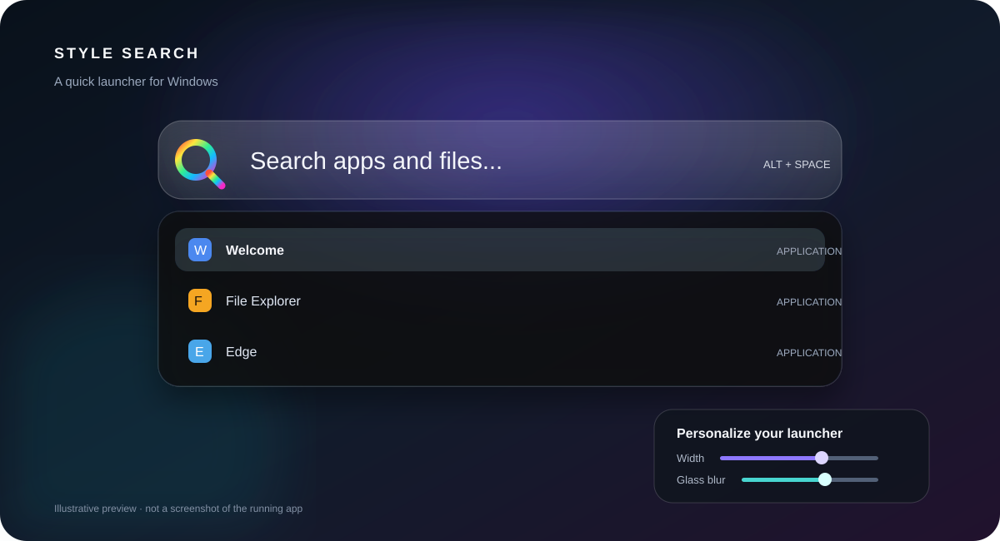

# Style Search

**A fast, keyboard-first app launcher for Windows.** Press a shortcut, find an installed app, and open it without leaving the keyboard.



> **Preview note:** This is an illustrative feature graphic, not a screenshot of the running application.

## Features

- **Quick launcher:** Open the search pill with **Alt + Space** by default. Change the global shortcut in Settings.
- **Application search:** Indexes Start Menu shortcuts and filters results as you type. Search terms that do not match an app can be sent to Google.
- **Keyboard navigation:** Use **↑ / ↓** to move through results, **Enter** to launch or paste, and **Esc** to go back, clear the query, or close the launcher.
- **Clipboard history:** Keeps up to 100 recent text clipboard entries and lets you search and paste them. Clipboard entries are stored locally as plain text; see [Privacy](#privacy).
- **Text snippets:** Includes date, time, and UUID snippets. Snippet bodies can use `{date}`, `{time}`, `{uuid}`, and `{clipboard}` placeholders.
- **Glass appearance controls:** Adjust launcher width, corner rounding, opacity, acrylic blur, glass intensity, shadow, row rounding, and footer visibility in Settings.
- **System tray controls:** Open the launcher, open Settings, toggle run-at-sign-in, or exit from the tray menu.
- **Windows installer:** The release bundle includes install and uninstall scripts, Start Menu and Desktop shortcuts, and an optional launch-at-sign-in entry.

## Get Style Search

Download **`Style-Search-v1.0.0-win-x64.zip`** from the [GitHub Releases](https://github.com/drake-forum/Style-Search/releases) page and extract the entire ZIP. Run **`Install Style Search.bat`** to install, or run `Install-Style-Search.ps1` from PowerShell. Windows may ask you to confirm that you trust the app because the release is not code-signed.

The app is published as a self-contained Windows x64 executable; the .NET runtime does not need to be installed separately. Keep the extracted release folder until installation completes. To remove the app, run **`Uninstall Style Search.bat`**. Uninstalling leaves user settings, snippets, and clipboard history in place.

## Shortcuts

| Shortcut | Action |
| --- | --- |
| `Alt + Space` | Show or hide the launcher (customizable in Settings) |
| `↑` / `↓` | Move through the current result list |
| `Enter` | Launch the selected app or paste the selected item |
| `Esc` | Back out of a mode, clear the query, or close the launcher |
| `Ctrl + 1` | App search mode |
| `Ctrl + 2` | Clipboard history mode |
| `Ctrl + 3` | Snippet mode |
| `Ctrl + ,` | Open Settings |

## Build from source

Requirements: Windows 10 or 11 (x64) and the **.NET 8 SDK**.

```powershell
dotnet restore .\StyleSearch.csproj
dotnet publish .\StyleSearch.csproj `
  -c Release `
  -r win-x64 `
  --self-contained true `
  -p:PublishSingleFile=true `
  -p:IncludeNativeLibrariesForSelfExtract=true `
  -o .\StyleSearch-win-x64
```

The output folder contains `StyleSearch.exe` and its logo assets. To use the installer scripts, keep that folder next to `Install-Style-Search.ps1` as shown in the release ZIP.

## Privacy

Style Search indexes Start Menu shortcuts on the device and does not require an account. Clipboard history polls the Windows text clipboard while the app is running, retaining up to 100 entries in `%LOCALAPPDATA%\AintoWindows\clipboard.json`. This file is local, stored as readable text, and is not encrypted. Snippets and appearance settings are stored alongside it in the same local app-data folder. Remove `clipboard.json` manually to clear saved clipboard history.

App searches that do not match an installed shortcut offer a Google web search. Choosing that result opens the search in your default browser.

## License and attribution

Style Search is released under **GNU GPL v3.0 or later**; see [LICENSE](LICENSE). This is an independent Windows application and is not affiliated with Apple or the developer of Ainto. The implementation is based on the project source in this repository and does not bundle the React liquid-glass library.

